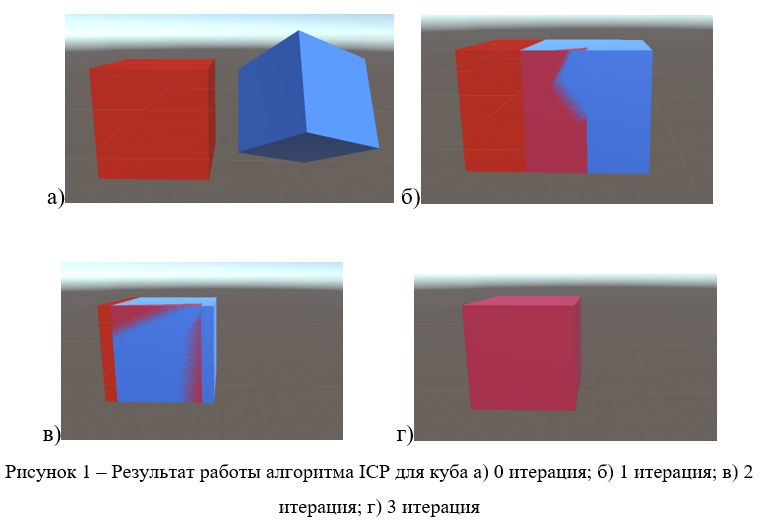

# Iterative Closest Point for Unity

**An interactive experiment in aligning 3D geometry.** A C# point-cloud registration prototype developed for a human–machine interface: compare scanned geometry with a reference mesh and explore the transform needed to align them.

**Stack:** Unity · C# · Math.NET Numerics · Supercluster.KDTree

**My role:** Danil Volodin — developed the Unity point-cloud alignment prototype.

## Try it in Unity

The repository contains assets and a historical Unity cache, but no committed `ProjectSettings/ProjectVersion.txt` or complete project configuration. Importing the relevant assets into a separate Unity project is the clearest starting point.

1. Create a Unity project and import `ICP/Assets/Scripts/icpalg.cs`.
2. Add compatible **Math.NET Numerics** and **Supercluster.KDTree** assemblies. Historical copies are present in `ICP/Assets/Plugins`; avoid importing duplicates if your project already supplies them.
3. Add the `icpalg` component to a manager object.
4. Assign the reference mesh to **M Game Object** and the moving mesh to **P Game Object**. Both require a `MeshFilter`.
5. Enter Play mode and enable **Start ICP** in the Inspector to request an update. Inspect the result and repeat as needed.

Start with simple, similarly oriented meshes with identity scale. Keep original copies of the objects while experimenting.

## Inside the experiment

- Uses vertices from two Unity `MeshFilter` components as point clouds.
- Finds nearest-neighbor correspondences with a KD-tree.
- Computes centroids and a quaternion-based alignment estimate with matrix operations.
- Applies the estimated position and rotation to the moving object.
- Exposes `startICP` in the Inspector for manually triggered alignment steps.

The core implementation is [`icpalg.cs`](ICP/Assets/Scripts/icpalg.cs). A demonstration scene lives at [`ICP/Assets/Scenes/SampleScene.unity`](ICP/Assets/Scenes/SampleScene.unity).

## How the code is organized

| Method | Role |
| --- | --- |
| `ParceFromVector3` | Collect mesh vertices with the object's positional offset |
| `KD_tree` | Build correspondences using nearest-neighbor queries |
| `FindCentroid` | Calculate the center of a point set |
| `ICP_run` | Estimate the transform and a summed squared correspondence error |
| `Update` | Run a requested step and apply the result to `PGameObject` |

## Example results

The original project documents demonstrations with cubes, capsules, cylinders and a more complex tree mesh.

## Important limitations

This is an educational prototype, not a validated registration library. The current source has known implementation limitations:

- The covariance terms currently repeat the same X-axis product; general rotation recovery needs correction and numerical tests.
- Mesh conversion adds object position but does not apply the full rotation/scale transform.
- There is no robust outlier rejection, convergence controller or benchmark suite.

The cube screenshot above preserves an original demonstration; it is not a claim of newly reproduced results. The code has not been changed as part of this documentation refresh.

## License

Original project code is available under the [MIT License](LICENSE). Bundled libraries and third-party assets retain their own licensing terms.
